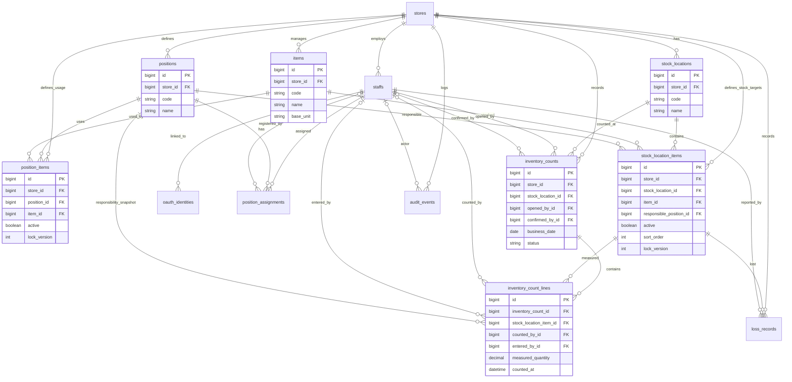

# ZAIKO ER図

- バージョン：0.1
- 対応Issue：#3
- ステータス：レビュー前
- 関連資料：[テーブル定義書](./tables.md) / [アソシエーション定義書](./associations.md)

## 1. 設計方針

- 全体のテーブル候補数は26件。
- Phase 1：13テーブル
- Phase 2：9テーブル
- Phase 3：4テーブル
- `auth_sessions` はPhase 3で実装する。
- 食材の使用ポジションと棚卸責任ポジションを分ける。
- 食材の物理在庫は食材×保管場所を基準に管理する。
- 棚卸責任者と実際の棚卸実施者を区別する。

本ER図は論理設計案であり、MigrationやDB構造は未確定。

## 2. 全体ER図（26テーブル）

```mermaid
erDiagram
    stores ||--o{ staffs : employs
    stores ||--o{ positions : defines
    stores ||--o{ items : manages
    stores ||--o{ stock_locations : has
    stores ||--o{ position_items : defines_usage
    stores ||--o{ stock_location_items : defines_stock_targets
    stores ||--o{ inventory_counts : records
    stores ||--o{ loss_records : records
    stores ||--o{ audit_events : logs
    stores ||--o{ suppliers : contracts
    stores ||--o{ purchase_orders : orders
    stores ||--o{ stock_transfers : transfers
    stores ||--o{ busy_periods : schedules

    staffs ||--o{ oauth_identities : linked_to
    staffs ||--o{ auth_sessions : sessions
    staffs ||--o{ position_assignments : assigned
    positions ||--o{ position_assignments : has
    staffs |o--o{ position_assignments : registered_by

    positions ||--o{ position_items : uses
    items ||--o{ position_items : used_by

    stock_locations ||--o{ stock_location_items : contains
    items ||--o{ stock_location_items : stocked
    positions ||--o{ stock_location_items : responsible

    stock_locations ||--o{ inventory_counts : counted_at
    staffs ||--o{ inventory_counts : opened_by
    staffs |o--o{ inventory_counts : confirmed_by

    inventory_counts ||--o{ inventory_count_lines : contains
    stock_location_items ||--o{ inventory_count_lines : measured
    staffs |o--o{ inventory_count_lines : counted_by
    staffs |o--o{ inventory_count_lines : entered_by
    positions |o--o{ inventory_count_lines : responsibility_snapshot

    stock_location_items ||--o{ loss_records : lost
    staffs ||--o{ loss_records : reported_by

    staffs |o--o{ audit_events : actor

    positions ||--o{ position_approval_authorizations : approval_scope
    staffs ||--o{ position_approval_authorizations : authorized_staff
    staffs ||--o{ position_approval_authorizations : granted_by

    items ||--o{ stock_transfers : transferred
    stock_locations ||--o{ stock_transfers : from_location
    stock_locations ||--o{ stock_transfers : to_location
    staffs ||--o{ stock_transfers : moved_by

    suppliers ||--o{ supplier_items : offers
    items ||--o{ supplier_items : purchased_as
    suppliers ||--o{ supplier_closures : closed_on
    suppliers ||--o{ supplier_delivery_rules : delivery_rules

    suppliers ||--o{ purchase_orders : receives
    positions ||--o{ purchase_orders : ordering_position
    staffs ||--o{ purchase_orders : requested_by

    purchase_orders ||--o{ purchase_order_lines : contains
    supplier_items ||--o{ purchase_order_lines : ordered_item
    positions |o--o{ purchase_order_lines : requested_position

    purchase_orders ||--o{ order_approval_events : approval_events
    staffs ||--o{ order_approval_events : approval_actor

    purchase_orders ||--o{ receipts : delivered
    staffs ||--o{ receipts : received_by

    receipts ||--o{ receipt_lines : contains
    purchase_order_lines ||--o{ receipt_lines : fulfills
    stock_locations ||--o{ receipt_lines : stored_at
```

### 全体図の注意点

- `auth_sessions` はPhase 3の候補として表示する。
- `stock_location_items` はPhase 1の採用方針。
- 同じ2テーブルを複数の外部キーで関連付ける場合、関連名を分ける。
- `audit_events` の監査対象は多態的な参照候補であり、通常のFK線は描いていない。
- 26テーブルの最終的なカラム・FK・必須性は後続Issueで確定する。

## 3. Phase 1 ER図（13テーブル）

上記のカラム表示は重要な関連・数量の抜粋であり、全カラムの正本は `tables.md` とする。

## 4. 特に重要な関連

### 食材と保管場所

`items` と `stock_locations` は、`stock_location_items` を介した多対多。

1種類の食材を複数の場所に保管できる。

同じ食材を複数ポジションが使用しても、在庫の二重計上をしない。

### 棚卸責任と実施者

`stock_location_items.responsible_position_id` は通常の責任ポジションを示す。

`inventory_count_lines.counted_by_id` は実際に数えたスタッフを示す。

後輩が代わりに棚卸した場合も、実施者を記録する。

### 棚卸と明細

`inventory_counts` と `inventory_count_lines` は1対多。

1回の棚卸に複数の食材明細が紐つく。
未確認の数量NULLと実測数量0は区別する。

### 発注と納品

発注書から複数の発注明細を持てる。
1件の発注に対して複数回の分納・検品が可能。
在庫に反映するのは検品確定済みの数量のみ。

### 店舗境界と複合FK

- `position_items` と `stock_location_items` は `store_id` を保持する。
- `position_items` は同一店舗の `positions` と `items` のみ参照できる。
- `stock_location_items` は同一店舗の `stock_locations`、`items`、`positions` のみ参照できる。
- 店舗の一致は `(store_id, 関連先ID)` の複合FKで保証する。
- 詳細なUNIQUE制約とFK制約は `tables.md` を正本とする。

## 5. 未確定事項

- Phase 1の棚卸ヘッダーの単位と複数回実施のルール
- 保管場所別管理食材の責任ポジション変更履歴
- 一部のFKの任意・必須条件
- 複数ポジションからの発注依頼の履歴管理
- 在庫訂正専用テーブルの必要性

詳細カラム・NULL・DEFAULT・UNIQUE・CHECK・INDEXは
`tables.md` で管理し、Issue #4〜#8で確定する。
