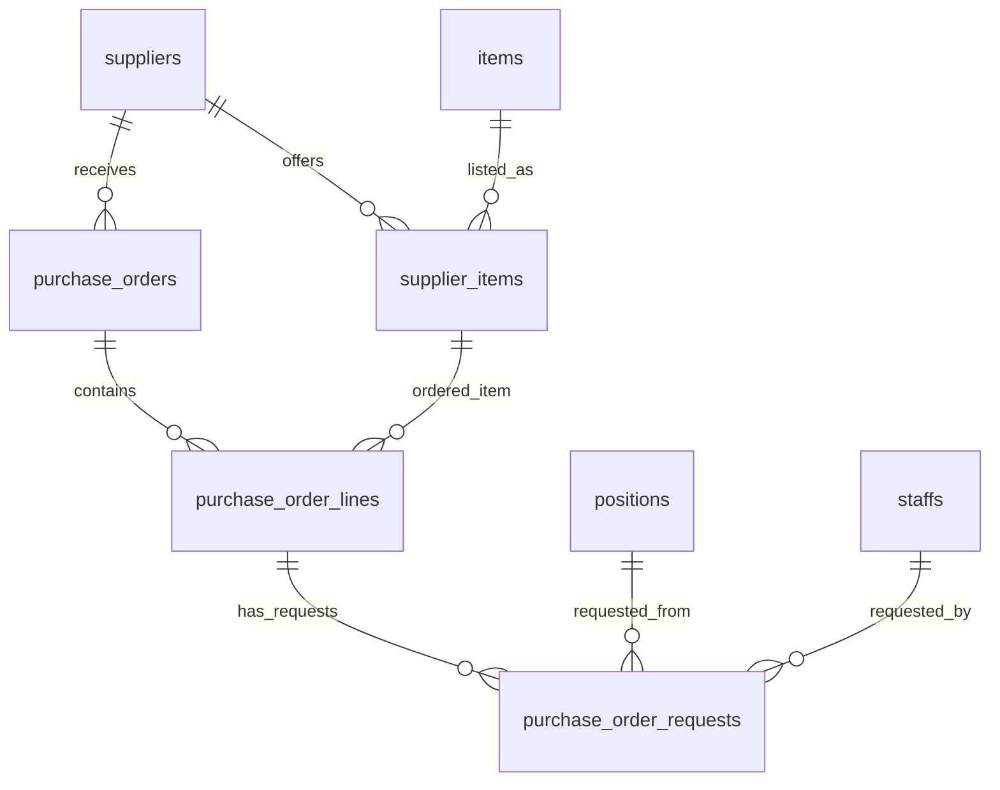
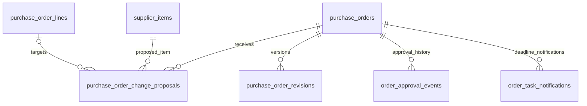

# ZAIKO ER図

- バージョン：0.2
- 対応Issue：#3、#7、#10
- ステータス：Issue単位で更新
- 関連資料：[テーブル定義書](./tables.md) / [アソシエーション定義書](./associations.md)

## 1. 設計方針

- ER図は開発中のIssueで確認するテーブルと関連に絞って掲載する。
- Issueが完了するごとに、確定したテーブルと関連を追加する。
- Phase 1の図は、Issue #7までに確定した在庫管理の関連を示す。
- Phase 2の図は、Issue #10で扱う発注作成・集約・変更提案・承認・送信の関連を示す。
- 納品・検品など後続Issueで扱うテーブルは、そのIssueで図に追加する。
- 詳細なカラム、FK、複合FK、UNIQUE制約は `tables.md` と `associations.md` を正本とする。

本ER図は論理設計を確認するための図であり、MigrationやDB構造の完成を意味しない。

## 2. Phase 1 ER図（Issue #7までに確定した範囲）

```mermaid
erDiagram
    stores ||--o{ staffs : employs
    stores ||--o{ positions : defines
    stores ||--o{ items : manages
    stores ||--o{ stock_locations : has
    stores ||--o{ position_items : defines_usage
    stores ||--o{ stock_location_items : defines_stock_targets

    staffs ||--o{ oauth_identities : linked_to
    staffs ||--o{ position_assignments : assigned
    positions ||--o{ position_assignments : has
    staffs |o--o{ position_assignments : registered_by

    positions ||--o{ position_items : uses
    items ||--o{ position_items : used_by

    stock_locations ||--o{ stock_location_items : contains
    items ||--o{ stock_location_items : stocked
    positions ||--o{ stock_location_items : responsible

    stores ||--o{ inventory_counts : records
    stock_locations ||--o{ inventory_counts : counted_at
    staffs ||--o{ inventory_counts : opened_by
    staffs |o--o{ inventory_counts : confirmed_by

    inventory_counts ||--o{ inventory_count_lines : contains
    stock_location_items ||--o{ inventory_count_lines : measured
    staffs |o--o{ inventory_count_lines : counted_by
    staffs |o--o{ inventory_count_lines : entered_by
    positions |o--o{ inventory_count_lines : responsibility_snapshot

    stores ||--o{ loss_records : records
    stock_location_items ||--o{ loss_records : lost
    staffs ||--o{ loss_records : reported_by

    stores ||--o{ audit_events : logs
    staffs |o--o{ audit_events : actor

    items {
        bigint id PK
        bigint store_id FK
        string code
        string name
        string base_unit
    }

    stock_locations {
        bigint id PK
        bigint store_id FK
        string code
        string name
    }

    positions {
        bigint id PK
        bigint store_id FK
        string code
        string name
    }

    position_items {
        bigint id PK
        bigint store_id FK
        bigint position_id FK
        bigint item_id FK
        boolean active
        int lock_version
    }

    stock_location_items {
        bigint id PK
        bigint store_id FK
        bigint stock_location_id FK
        bigint item_id FK
        bigint responsible_position_id FK
        boolean active
        int sort_order
        int lock_version
    }

    inventory_counts {
        bigint id PK
        bigint store_id FK
        bigint stock_location_id FK
        bigint opened_by_id FK
        bigint confirmed_by_id FK
        date business_date
        string status
    }

    inventory_count_lines {
        bigint id PK
        bigint inventory_count_id FK
        bigint stock_location_item_id FK
        bigint counted_by_id FK
        bigint entered_by_id FK
        decimal measured_quantity
        datetime counted_at
    }
```

上記のカラム表示は重要な関連・数量の抜粋であり、全カラムの正本は `tables.md` とする。

上記のカラム表示は重要な関連・数量の抜粋であり、全カラムの正本は `tables.md` とする。

## 3. Phase 2：発注作成・依頼集約（Issue #10）

この図では、仕入先別商品を発注明細にまとめ、依頼元ごとの依頼数量を保持する関連を示す。

## 4. Phase 2：提案・承認・内容版・期限通知（Issue #10）

この図では、提案判断と承認・送信の根拠になる発注内容版、期限通知の関連を示す。取消明細は `purchase_order_lines` に論理状態を保持し、元の依頼・提案・内容版との参照を維持する。

提案者・判断者・承認者・通知先スタッフとの関連、および各FKの店舗一致条件は `tables.md` と `associations.md` を参照する。図は主要な業務関係に絞っている。

## 5. 特に重要な関連

### 食材と保管場所

`items` と `stock_locations` は、`stock_location_items` を介した多対多。

1種類の食材を複数の場所に保管できる。同じ食材を複数ポジションが使用しても、在庫の二重計上をしない。

### 棚卸責任と実施者

`stock_location_items.responsible_position_id` は通常の責任ポジションを示す。`inventory_count_lines.counted_by_id` は実際に数えたスタッフを示す。後輩が代わりに棚卸した場合も、実施者を記録する。

### 棚卸と明細

`inventory_counts` と `inventory_count_lines` は1対多。1回の棚卸に複数の食材明細が紐づく。未確認の数量NULLと実測数量0は区別する。

### 発注と内容版

1件の発注書は複数の発注明細・依頼・変更提案・内容版・承認履歴・期限通知を持てる。承認・PDF・送信は同一の内容版番号を参照し、明細取消後も履歴参照を維持する。送信後の変更・取消は後続Issueで扱う。

### 店舗境界と複合FK

- 関連レコードは同じ店舗に属する必要がある。
- 店舗一致、発注書と明細の所属、仕入先と仕入先別商品の一致をDB制約またはService検証で保証する。
- 詳細なUNIQUE制約とFK制約は `tables.md` と `associations.md` を正本とする。

## 6. 後続Issueで図に追加する範囲

- 発注書に対する納品・検品の実績（`receipts`、`receipt_lines`）
- 仕入先休業日・納品ルール
- 在庫移動・繁忙期分析・追加セッション管理

これらはIssueごとにテーブル間の関連を確認してから追加する。
